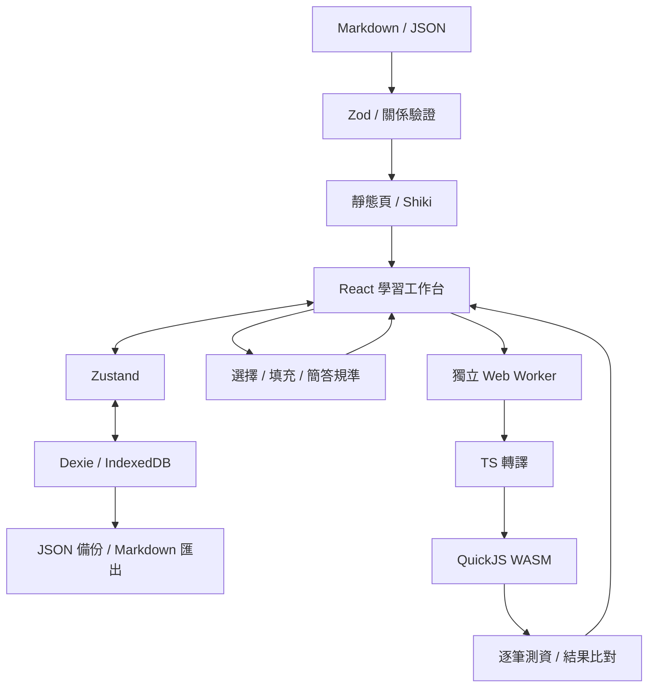
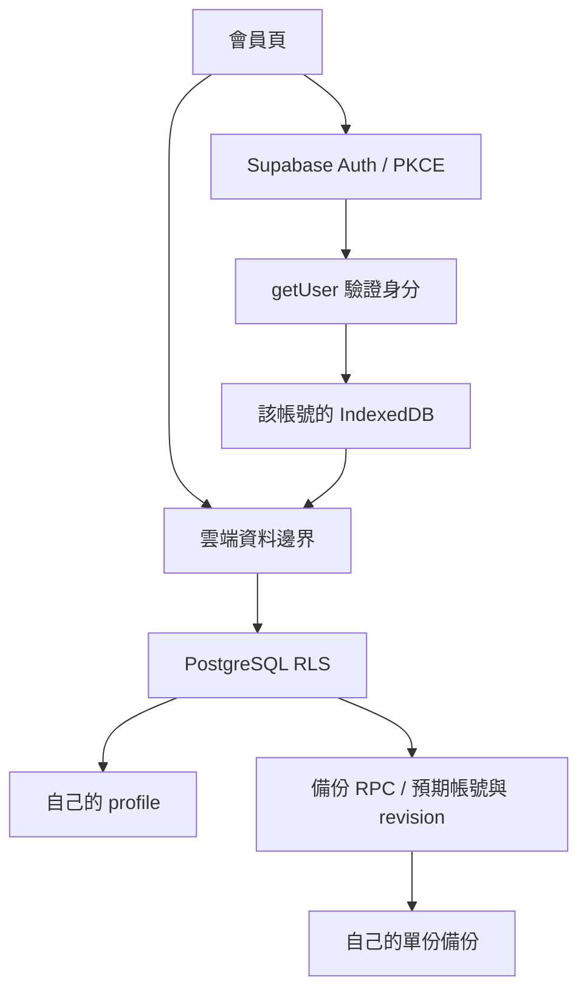

# 架構

採靜態網站與本機優先的資料模型：GitHub 保存教材與程式，Build 時驗證內容並產生頁面；瀏覽器負責作答、筆記與練習程式執行。本機功能不需要 API key；可選的會員與備份透過 Supabase SDK 接入。

## 目錄與責任

| 目錄                  | 責任                                             |
| --------------------- | ------------------------------------------------ |
| `src/app`             | 靜態路由、metadata 與 layout                     |
| `src/content`         | 讀取教材、驗證 ID、先修與題目規則                |
| `src/core`            | 評分、輸出比對、anchor 與執行契約                |
| `src/workers`         | 接收經 Zod 驗證的程式執行請求                    |
| `src/storage`         | IndexedDB、資料版本、備份與工作區狀態            |
| `src/auth`            | Auth SDK、PKCE、會員狀態、profile 與雲端備份邊界 |
| `supabase/migrations` | 版本化表結構、RLS 與備份 CAS 函式                |
| `src/components`      | 教材、題型、編輯器與筆記介面                     |
| `tests`               | 執行器、評分、內容與資料庫操作測試               |

## 三個資料邊界

1. 作者教材：Build 時載入，Markdown raw HTML 停用，Shiki 轉換程式碼。
2. 學員程式：Worker 執行 QuickJS guest，不直接交給頁面的 JavaScript 引擎。
3. 個人資料：預設存在目前 origin 的 IndexedDB；依訪客或已驗證帳號分開。只有明確操作才匯入訪客或備份至雲端；所有匯入先驗證整包格式，再於 transaction 合併。

QuickJS 只接入有上限的 Console；不傳入 DOM、fetch、儲存、module loader 或任何憑證。每筆測資新建 context，設定 time、memory、stack 限制，結束時釋放。主頁面另可終止 Worker。

這仍是客戶端自學平台。使用者能查看題庫或修改本機程式與成績，不提供權威評分或防作弊保證。

## 本機保存

| 資料表   | 主鍵                             | 保存內容                             |
| -------- | -------------------------------- | ------------------------------------ |
| notes    | note ID                          | 整頁或 anchor、本文、教材版本、時間  |
| attempts | attempt ID                       | 題目版本、grader version、答案與結果 |
| progress | lesson ID                        | 是否已讀與更新時間                   |
| drafts   | question ID + version + language | JS／TS 分開保存的程式草稿            |

筆記與程式草稿在編輯時保存；資料庫失敗會顯示提示，記憶體中的內容仍可匯出。備份匯入不清空資料表，同 ID 保留較新更新時間；相同 attempt ID 不重複加入。

訪客繼續使用原有的 `dev-map-lab-v1` DB；會員 DB 使用 project namespace + user UUID，避免不同專案或帳號混用。新增的 `imports` 表記錄訪客筆記匯入來源，避免相同資料在同一個本機空間重複附加；它不包含於可攜備份。

工作區以 generation 忽略過期的讀取結果；寫入開始時固定 DB，不讓切換帳號把待存資料送進新 DB。非同步評分與檔案讀取也會檢查 generation，畫面依 scope 重建編輯器。callback 頁保持穩定，避免在 scope 切換時重複使用一次性授權碼。

## 會員與手動備份

前端只有 publishable key，沒有 service_role。Auth callback 採 PKCE，`next` 只接受站內路徑；一次性 code 會在交換前從網址列移除。重設密碼的短期標記只控制 UI，變更密碼仍須由 Auth 的有效 session 授權。

雲端按 user_id 各保存一份 v1 backup，client 與 SQL 分別檢查格式與 5 MB 上限。已有備份時先合併；上傳透過 invoker RPC 做原子版本檢查，版本不符回報衝突。這一版沒有背景同步、刪除墓碑、跨裝置衝突副本或可信任成績，因此不把它視為完整同步協定。

RLS 限制已登入者只能讀寫自己的資料，不能讀取其他 user_id。SDK 的預先 getUser 檢查改善錯誤回饋；真正的資料權限由 PostgreSQL 執行。RPC 額外比對 expected_user_id，避免送出前切換 session 時把舊帳號內容存入新帳號。

## 註記定位

整頁筆記綁 lesson ID。段落筆記加上固定 block ID；文字註記再記錄 quote、prefix、suffix 與 UTF-16 起訖位置。

先驗證原位置及前後文；若不符，再搜尋唯一符合的文字位置。找不到或有多個符合點時不猜測，提示原文變更並保留筆記。教材變更時增加 lesson version。

## 後續串接位置

- Auth 啟用：選定獨立免費專案、設定 Email SMTP／callback，依 [會員指南](MEMBERSHIP.md) 做真實流程驗證。
- Sync：在現有手動備份邊界增加操作紀錄、刪除墓碑、衝突副本與重試佇列，不讓頁面直接操作雲端資料表。
- 離線模型：實作 `SemanticEvaluator`，再用人工標註集校準每題門檻，最後於 Worker 接入。
- 正式部署：使用目前 static export；要增加 Server Actions 或可信任 Judge，先調整架構與成本條件。
- 完整離線站點：另加入 Service Worker、資源版本與更新策略；目前不預先宣稱支援。
