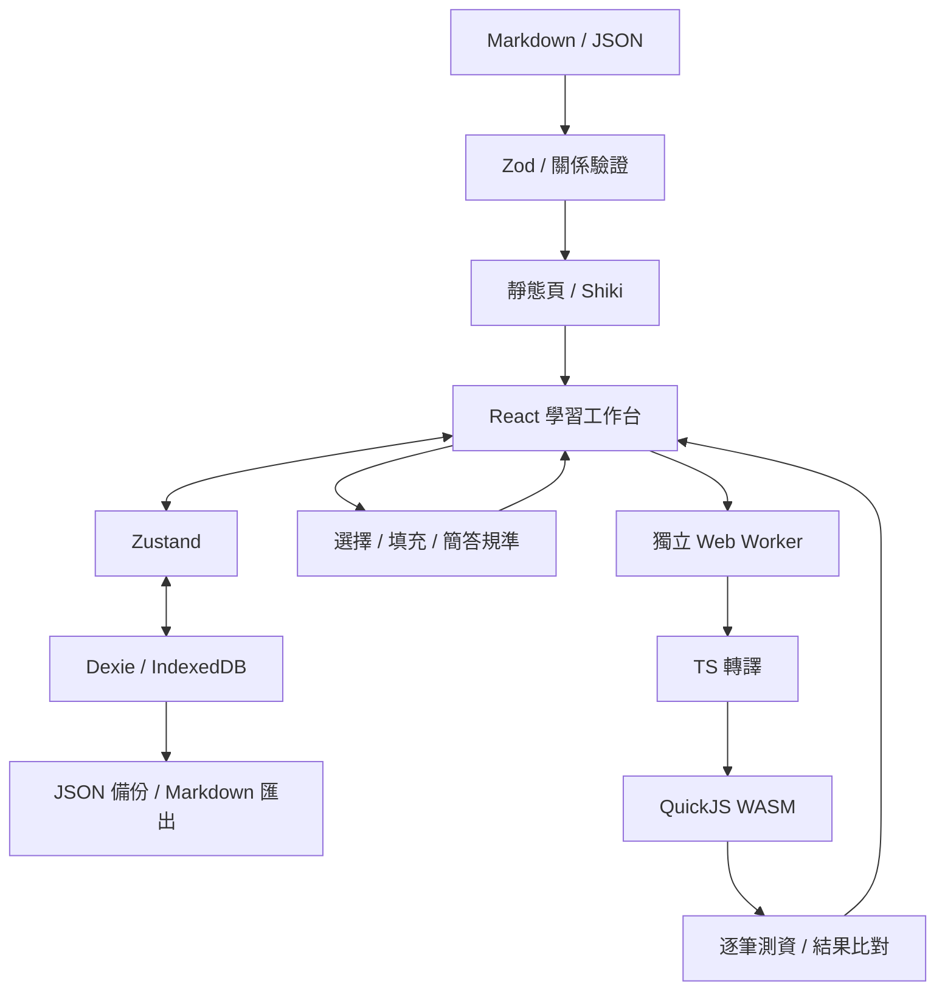

# 架構

目前採本機資料與靜態網站：GitHub 保存教材與程式，Build 時驗證內容並產生頁面；瀏覽器負責作答、筆記與練習程式執行。不需要 API key 或雲端帳號。

## 目錄與責任

| 目錄             | 責任                                  |
| ---------------- | ------------------------------------- |
| `src/app`        | 靜態路由、metadata 與 layout          |
| `src/content`    | 讀取教材、驗證 ID、先修與題目規則     |
| `src/core`       | 評分、輸出比對、anchor 與執行契約     |
| `src/workers`    | 接收經 Zod 驗證的程式執行請求         |
| `src/storage`    | IndexedDB、資料版本、備份與工作區狀態 |
| `src/components` | 教材、題型、編輯器與筆記介面          |
| `tests`          | 執行器、評分、內容與資料庫操作測試    |

## 三個資料邊界

1. 作者教材：Build 時載入，Markdown raw HTML 停用，Shiki 轉換程式碼。
2. 學員程式：Worker 執行 QuickJS guest，不直接交給頁面的 JavaScript 引擎。
3. 個人資料：只存目前 origin 的 IndexedDB；備份匯入先驗證整包格式，再於 transaction 合併。

QuickJS 只接入有上限的 Console；不傳入 DOM、fetch、儲存、module loader 或任何憑證。每筆測資新建 context，設定 time、memory、stack 限制，結束時釋放。主頁面另可終止 Worker。

這仍是客戶端自學平台。使用者能查看題庫或修改本機程式與成績，不提供權威評分或防作弊保證。

## 本機保存

| 資料表   | 主鍵                             | 保存內容                             |
| -------- | -------------------------------- | ------------------------------------ |
| notes    | note ID                          | 整頁或 anchor、本文、教材版本、時間  |
| attempts | attempt ID                       | 題目版本、grader version、答案與結果 |
| progress | lesson ID                        | 是否已讀與更新時間                   |
| drafts   | question ID + version + language | JS／TS 分開保存的程式草稿            |

筆記與程式草稿在編輯時保存；資料庫失敗會顯示提示，記憶體中的內容仍可匯出。備份匯入不清空資料表，同 ID 保留較新更新時間；相同 attempt ID 不重複加入。

## 註記定位

整頁筆記綁 lesson ID。段落筆記加上固定 block ID；文字註記再記錄 quote、prefix、suffix 與 UTF-16 起訖位置。

先驗證原位置及前後文；若不符，再搜尋唯一符合的文字位置。找不到或有多個符合點時不猜測，提示原文變更並保留筆記。教材變更時增加 lesson version。

## 後續串接位置

- Auth：新增帳號與本機資料歸屬流程，不能直接把匿名資料默認分享給其他帳號。
- Sync：在 storage 邊界增加 repository adapter、衝突版本與重試，不讓頁面直接操作雲端資料表。
- 離線模型：實作 `SemanticEvaluator`，再用人工標註集校準每題門檻，最後於 Worker 接入。
- 正式部署：使用目前 static export；要增加 Server Actions 或可信任 Judge，先調整架構與成本條件。
- 完整離線站點：另加入 Service Worker、資源版本與更新策略；目前不預先宣稱支援。
